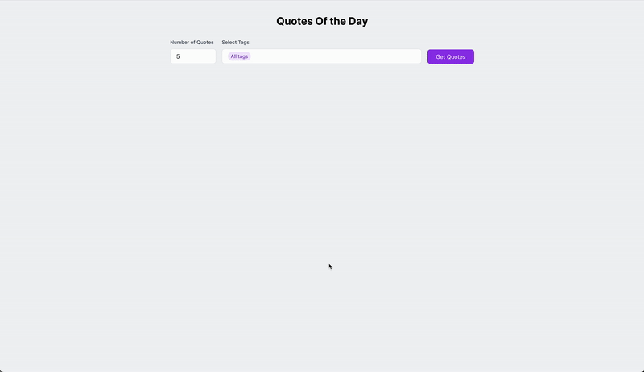

# Quotes of the Day App

A full-stack application that fetches and displays random quotes using the FavQs API. Built with React, Node.js/TypeScript, and modern web technologies.



## Features

- 🎯 Get random quotes by specifying the number of quotes you want
- 🏷️ Search quotes by tags
- 💾 Search history tracking (optional with database connection)
- ⚡ Rate limit handling for optimal API usage
- 🎨 Modern and responsive UI
- 🚀 Production-ready code with error handling

## Getting Started

### Prerequisites

- Node.js (v16 or higher)
- npm or yarn
- MongoDB (optional - for search history feature)

### Backend Setup

1. Navigate to the backend directory:
```bash
cd backend
```

2. Install dependencies:
```bash
npm install
```

3. Set up environment variables:
```bash
cp .env.example .env
```
Edit `.env` file and add your FavQs API key:
```
FAVQS_API_KEY=your_api_key_here
```
You can get your API key by signing up at [FavQs](https://favqs.com/api)

4. Start the development server:
```bash
npm run dev
```

The backend will run on `http://localhost:8000` by default.

### Frontend Setup

1. Navigate to the frontend directory:
```bash
cd frontend
```

2. Install dependencies:
```bash
npm install
```

3. Start the development server:
```bash
npm start
```

The frontend will run on `http://localhost:3000` by default.

## Database Implementation (Optional & Not Active)

While the assignment mentioned implementing a database, I chose to implement PostgreSQL for search history as an additional feature. However, this feature is not actively used in the running application for the following reasons:

1. The core features (random quotes and tag search) don't require a database
2. Setting up PostgreSQL adds unnecessary complexity for running the demo
3. The database code exists in the codebase but is not called during normal operation

If you're interested in the database implementation:
- Check `backend/src/services/db.service.ts` for the PostgreSQL integration
- The schema includes tables for tracking search history
- All database calls are wrapped in try-catch blocks to ensure the app works without DB connection

The application is designed to run completely without database connectivity, focusing on the core quote functionality requested in the assignment.

### Database Schema (Reference Only)
```sql
CREATE TABLE search_history (
    id SERIAL PRIMARY KEY,
    query VARCHAR(255) NOT NULL,
    type VARCHAR(50) NOT NULL,
    created_at TIMESTAMP DEFAULT CURRENT_TIMESTAMP
);
```

## Code Structure

### Backend Architecture

```
backend/
├── src/
│   ├── controllers/    # Request handlers
│   ├── services/       # Business logic
│   ├── routes/         # API routes
│   ├── middlewares/    # Custom middlewares
│   ├── types/          # TypeScript types
│   └── utils/          # Helper functions
```

Key Features:
- TypeScript for type safety
- Express.js with modern async/await patterns
- Rate limiting and caching for FavQs API
- Error handling middleware
- Request validation
- Optional MongoDB integration

### Frontend Architecture

```
frontend/
├── src/
│   ├── components/     # Reusable UI components
│   ├── pages/         # Page components
│   ├── services/      # API services
│   ├── types/         # TypeScript types
│   └── utils/         # Helper functions
```

Key Features:
- React with TypeScript
- Modern hooks pattern
- Responsive design
- Error boundary implementation
- Loading states and error handling
- Clean and maintainable component structure

## API Endpoints

### Get Random Quotes
```
GET /api/quotes/random?count={number}
```

### Get Quotes by Tag
```
GET /api/quotes/tag/{tagName}
```

### Search History (if DB enabled)
```
GET /api/history
```

## Contributing

1. Fork the repository
2. Create your feature branch (`git checkout -b feature/AmazingFeature`)
3. Commit your changes (`git commit -m 'Add some AmazingFeature'`)
4. Push to the branch (`git push origin feature/AmazingFeature`)
5. Open a Pull Request

## License

This project is licensed under the MIT License - see the LICENSE file for details. 